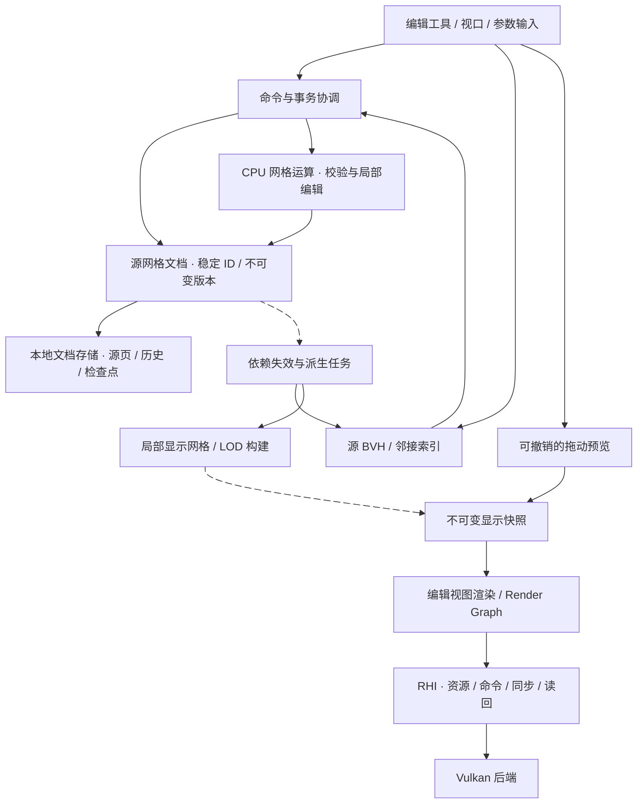
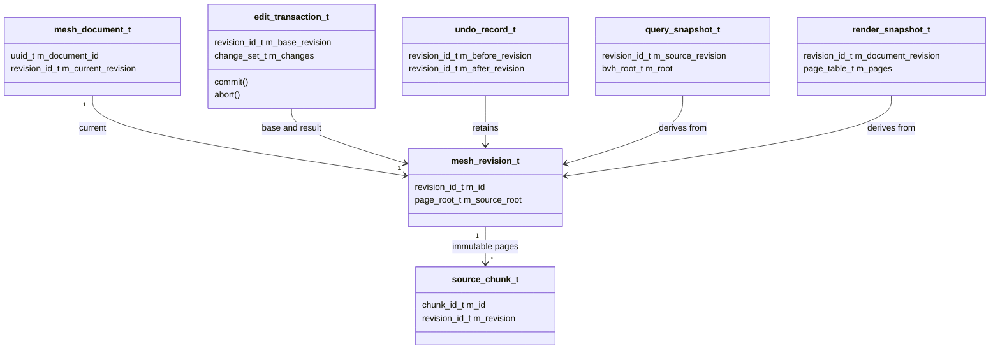
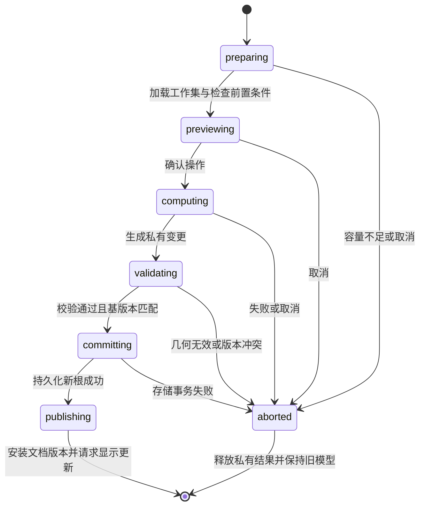
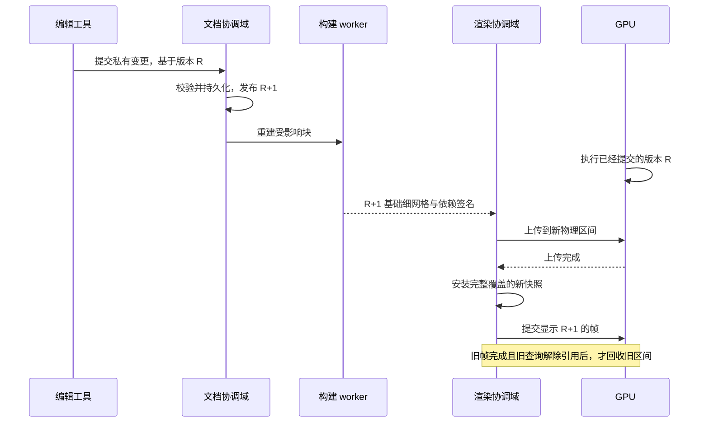
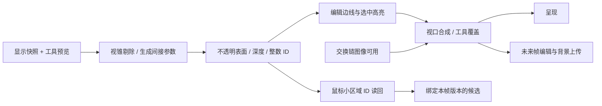

# DragonFly 网格编辑器与 RHI 架构

本文面向 **16 GiB RAM、8 GiB 独立显存**的跨平台三角网格编辑器：既要有游戏引擎式的交互响应，也要支持工业软件中的源网格编辑、尺寸测量、稳定选择、撤销重做和可靠保存。主线是三角网格；CAD 实体、曲面参数化和完整约束求解不作为当前系统的前提。

当前项目已有 DragonFly 共享库、public_api 模块和 SandBox 调用示例；网格编辑器与 RHI 功能仍是待实施设计，尚无相应性能报告。容量是初始配置，帧率与操作耗时必须在具体 CPU、GPU、驱动和磁盘上测量。接口声明、C ABI、结构体多态和模块导出见 [RHI 接口与 ABI](rhi-interfaces.md)，命名和排版统一遵循 [代码与文档约定](code-style.md)。本文只定义职责、数据、算法流程和实现边界。

- [0. 当前项目基础与接入方式](#0-当前项目基础与接入方式)
- [1. 产品能力与验收边界](#1-产品能力与验收边界)
- [2. 分层与数据归属](#2-分层与数据归属)
- [3. 源网格、身份与拓扑](#3-源网格身份与拓扑)
- [4. 精度如何定义和实现](#4-精度如何定义和实现)
- [5. 16 GiB RAM 与 8 GiB VRAM 预算](#5-16-gib-ram-与-8-gib-vram-预算)
- [6. 十亿面片的磁盘组织与工作集](#6-十亿面片的磁盘组织与工作集)
- [7. 编辑命令的执行与提交](#7-编辑命令的执行与提交)
- [8. 局部重建与一致画面](#8-局部重建与一致画面)
- [9. 拾取、吸附、测量与标注](#9-拾取吸附测量与标注)
- [10. 撤销、保存与崩溃恢复](#10-撤销保存与崩溃恢复)
- [11. CPU 线程与协程调度](#11-cpu-线程与协程调度)
- [12. GPU 调度与 RHI 底层](#12-gpu-调度与-rhi-底层)
- [13. 浏览、编辑与参考出图](#13-浏览编辑与参考出图)
- [14. 故障处理与实际操作案例](#14-故障处理与实际操作案例)
- [15. 目录、实施阶段与测试](#15-目录实施阶段与测试)

## 0. 当前项目基础与接入方式

本设计在现有工程上扩展。当前文件与后续责任的对应关系如下：

| 当前位置 | 已有职责 | 接入方向 |
| --- | --- | --- |
| [根 CMakeLists.txt](../CMakeLists.txt) | C/C++ 工程，采用 Clang/libc++、C++23 与标准库模块 | 记录当前工具链配置 |
| [DragonFly/CMakeLists.txt](../DragonFly/CMakeLists.txt) | 生成 DragonFly 共享库，公开 public 头文件与模块，构建 private 实现 | RHI 和编辑器内部组件首先属于这个 SDK 目标 |
| [DragonFly/public](../DragonFly/public/) | public_core.h、公用头文件和 public_api.cppm | 继续作为 C 入口与 C++23 模块的公开边界 |
| [DragonFly/private/private_imp.cpp](../DragonFly/private/private_imp.cpp) | drawable 演示的 C++ 实现 | 保留演示，新增组件按职责进入 private 子目录 |
| [SandBox](../SandBox/) | 模块消费与创建/销毁示例 | 扩展为最小渲染、编辑、回放和恢复验证入口 |
| [reference_build.sh](../reference_build.sh) | Linux 下手工构建 Clang/libc++ 模块的示例 | 与 CMake 入口分开 |

新增 RHI 公共声明通过拟建的 public_rhi.h、public_rhi_iface.h 和 public_rhi_wsi.h 分组，汇总头文件仍为 public_api.h，模块仍为 public_api。内部使用项目配置的 C++23；GPU 后端、网格算法、存储实现不通过 C++ 类布局暴露给 SDK 调用者。

当前 drawable 类型是头文件、模块和实现之间的演示，已修复公共宏、C 兼容、字段命名和示例生命周期。设备、命令池、编辑事务或源模型仍未实现；基础修正集中记录在风格文档。

## 1. 产品能力与验收边界

系统同时维护三类数据：

| 数据 | 保存的内容 | 可以怎样使用 |
| --- | --- | --- |
| 源模型 | 源坐标、顶点与面的稳定 ID、拓扑、属性、单位、对象变换和编辑历史 | 编辑、测量、精确查询、导出与保存的依据 |
| 查询数据 | 源模型的分块包围、局部 BVH、邻接与边界索引 | 加速查找；必须匹配源模型版本，可以重建 |
| 显示数据 | 相机相对顶点、簇、LOD、压缩页、间接绘制和 GPU 资源 | 快速浏览与编辑反馈，可以降质或重建，不回写覆盖源模型 |

**十亿面片是整个文档的源数据规模；直接交互编辑的是有界工作集。** 可以移动十亿面资产的一个对象实例而只更新变换，也可以编辑局部一万个顶点；不能据此承诺每个鼠标事件都重建十亿面的邻接、布尔结果或全局最优网格。

首版实际能力按下面的边界建设，编辑能力从第一个可交付版本开始进入主线：

| 能力 | 首版落地 | 较重情况 |
| --- | --- | --- |
| 对象与实例 | 变换、显示隐藏、分组、实例独立化 | 移动实例保留共享几何；修改共享源网格前明确影响全部实例还是先独立化 |
| 网格编辑 | 顶点移动，面删除，局部边分裂/折叠；保留属性和边界语义 | 逐个实现并校验；受影响闭包超过预算时缩小选择或转后台 |
| 精确交互 | 对源三角形拾取、顶点/边吸附、坐标输入、距离/角度/面积测量 | 冷数据可等待；不把 LOD 或深度图读数当作最终测量 |
| 编辑体验 | 拖动预览、局部高亮、线框、裁切显示、撤销重做、保存 | 预览、已提交和已保存分别有明确状态 |
| 后续网格操作 | 挤出、焊接、平滑、局部重网格、截切、布尔 | 声明流形等前置条件、输入闭包和资源估算，失败保留旧模型 |
| 全库操作 | 分批检查、导出、构建索引和代理 | 有进度、取消和磁盘预算；全局布尔、全局求解器不能仅靠分页获得有界实现 |

交互默认 1080p、两个在途帧槽。先做单活动视口，之后支持四分屏共享几何；四分屏在同一 1080p 窗口内分区，不默认分配四套 1080p 附件。浏览从每帧约 200 万个实际光栅三角形起测，编辑工作集从约 100 万源面起测，包含相邻区域后初始计数上限为 200 万面；字节额度先于面数限制生效。

暖缓存浏览先以 30 FPS 为验收目标，拖动输入到预览以 P95 小于 50 ms 为目标，再争取 60 FPS。局部编辑提交、精确拾取冷加载、保存和后台操作分别计时，不把它们都包装成“一帧完成”。帧率报告必须同时记录画质、编辑完成状态和实际处理面数。

## 2. 分层与数据归属

RHI 负责执行 GPU 工作。网格的拓扑、精度、事务、撤销和文件格式属于它上面的编辑器与模型层。这样更换 Vulkan 后端或清空 GPU 缓存都不会改变模型内容。



动画边表示源数据变化和显示结果发布；预览器不支持动画语法时可关闭这两条动画声明。它不是线程或硬件同时运行的保证。 [Mermaid 动画语法](https://mermaid.js.org/syntax/flowchart.html#turning-an-animation-on)

| 数据或状态 | 唯一修改者 | 跨线程交接 |
| --- | --- | --- |
| 当前文档根、命令历史、实体 ID 分配 | 文档协调域 | 不可变版本引用与变更集 |
| 编辑中的临时结果 | 本次操作拥有者 | 成功结果或错误，不能直接改当前文档 |
| 数据库写入与恢复元数据 | 一个存储写入域 | 有版本的持久化请求与完成通知 |
| 查询索引 | 查询构建任务生成，协调域安装 | 输入页版本、索引版本和有效范围 |
| 显示快照与驻留目录 | 渲染协调域 | 帧只读快照、资源保活集合 |
| GPU 命令池 | 正在录制的单个 worker | 已结束的命令列表 |
| 任务依赖与完成 | 调度器 | 一次性结果和后继通知 |

文档修改串行发布，计算可以并行。第一版同时只允许一个写入文档的网格编辑事务；相机、选择和只读查询仍可运行。后续若要并发编辑不同区域，必须增加读写集冲突检查，不能只给每个块加一把锁就宣称事务完成。

## 3. 源网格、身份与拓扑

### 3.1 源格式与编辑工作格式分开

磁盘源数据采用按块存放的连续数组：FP64 位置、块内索引、稳定顶点/面 ID、属性流和跨块边界记录。UV、法线和材质接缝按面角或明确的属性域保存；共享空间位置不意味着共享所有渲染属性。导入时记录单位、轴向、原始精度、退化面、非流形边和重复面，不默默修复源数据。

运行时只为正在编辑的区域建立密集索引、半边或等价邻接结构。首版使用连续数组和局部 ID 查找表，不给全库每个顶点、面或半边分配一个 C++ 小对象。只读浏览不加载完整邻接。

源块的初始上限为 65536 个面，实际还受序列化尺寸约束；位置、索引和属性可拆成多个不超过 4 MiB 的存储页。渲染缓存另用 64 KiB 几何页。两种页尺寸服务不同访问方式，不要求一一对应。

跨块顶点有唯一的源记录所有者，其他块保存引用；派生显示页允许复制顶点。源 ID 到所有者和关联块的反向索引也按磁盘页存放。编辑边界顶点时先读出全部相关块；出现高价顶点或异常非流形邻接时，闭包可能远大于鼠标圈选范围，此时按实际内存拒绝或转后台，不能只更新已加载副本。

### 3.2 稳定身份

- 文档和网格资源使用持久 UUID；资源内顶点、边、面使用不复用的 64 位 ID。对象实例另有独立 ID。
- GPU 槽位、数组下标、压缩后的图元序号均为临时身份，不进入标注、历史或保存数据。
- 拓扑编辑产生明确的“保留、生成、分裂、合并、删除”映射。一个面分裂后旧面不能任意指向某一个子面；引用按工具规则重新定位，无法唯一定位就标为待修复。
- 对普通流形边可用端点关系加速查询，但边的持久身份不能仅由两个端点推出；并行边、非流形情况和边替换需要独立记录。
- 重编号、重新分块或重建 LOD 不改变源实体 ID。Undo 恢复原 ID，Redo 复用该命令原先生成的 ID；新分支从未使用的范围继续分配。

内部关系如下，成员命名遵循已约定的 m_ 前缀与类型 _t 后缀。下列内部类型拟放在 DragonFly/private 对应子目录中；此图不定义公开 ABI。



## 4. 精度如何定义和实现

### 4.1 区分数据精度、计算正确性和显示误差

| 项目 | 实施约定 | 不得混淆的情况 |
| --- | --- | --- |
| 坐标与单位 | 源位置与对象变换以 FP64 保存；文档保存长度单位与转换规则 | FP32 导入数据升级到 FP64 后，已经丢失的信息不会恢复 |
| 几何判断 | 共线、朝向、交叉等关键谓词采用经过验证的自适应/精确谓词实现 | 单纯把 float 换成 double 不能保证退化情况下的拓扑判断正确 |
| 新点构造 | 普通变换用 FP64；复杂相交按算法需要使用精确构造或有误差界的构造 | 精确谓词不自动使新交点坐标精确 |
| 显示 | 块局部位置、相机相对变换和 LOD；编辑区使用源拓扑生成的细网格 | 屏幕像素和深度缓冲不是尺寸测量依据 |
| 测量 | 从指定源版本计算，结果带单位、方法、容差和有效状态 | 数字显示很多小数位不等于达到相应准确度 |
| 导出 | 固定文档版本，导出源数据或明确选择的简化结果 | 降级为 FP32 或改变单位须报告误差；不默认导出当前 LOD |

首版几何算法适配层复用成熟实现：局部编辑由自有事务层组织，复杂谓词、相交与网格处理可接入锁定版本并通过回归测试的 CGAL 模块。只将活动区域转成算法库要求的工作结构，转换副本计入操作临时区。不会把整份十亿面网格转成库的内存对象。精确谓词与精确构造具有不同语义，算法输入也各有拓扑前置条件。 [CGAL 数值内核](https://doc.cgal.org/latest/Kernel_23/index.html) · [CGAL 网格处理](https://doc.cgal.org/latest/Polygon_mesh_processing/index.html)

位置、拓扑和容差变化都进入同一个事务。若算法使用精确构造而持久格式仍保存 FP64，提交前必须显式舍入、记录误差并重新校验结果；不能把舍入后的结果继续称为精确构造结果。未来需要持续保存有理数坐标时扩展源数据格式，首版不做此承诺。

### 4.2 容差不采用全局固定 epsilon

文档保存单位、导入数据的不确定性、建模容差和测量验收要求。不同用途分别设定焊接距离、退化判断、拾取屏幕半径、显示误差，不能共享一个常量。

例如要求测量到 0.01 mm：先确认输入本身和算法误差是否支持这个要求，再按预算验收。输入是毫米级精度的扫描数据时仍保留测量结果，但不宣称达到 0.01 mm 的物理准确度。原本开放或自相交的网格，体积测量需返回不适用或明确的特殊定义。

屏幕 LOD 阈值可从 0.5 像素起测，但这只是显示质量参数。简化算法的估计误差不作为工业尺寸约束；正式测量始终回到源网格。 [meshoptimizer 简化误差说明](https://github.com/zeux/meshoptimizer/discussions/735)

### 4.3 大坐标与局部精度

对象变换保留 FP64，导入时建立可逆的局部原点，避免在大世界坐标上反复叠加小位移。CPU 在 FP64 下计算块原点相对相机的位置，再转换显示所需数据；不能先转 FP32 再相减。极端大坐标、非均匀缩放和病态矩阵须检测并拒绝不可靠计算。

编辑区使用不量化或经检验的局部顶点。根据最大局部坐标与浮点误差估计显示位移；不满足目标就细分显示块或启用经过验证的高低位坐标着色路径。反向 Z 改善深度分布，但不会提高源坐标精度，也不能彻底解决共面闪烁。线框和高亮的深度偏移只影响显示，不参与拾取与测量。 [深度精度分析](https://developer.nvidia.com/blog/visualizing-depth-precision/)

## 5. 16 GiB RAM 与 8 GiB VRAM 预算

编辑器需要为源拓扑、事务和查询预留内存。以下均是**整个进程/设备的分类额度，含两个帧槽和全部 worker**，不能按线程、视口或帧数再次相乘；按需分配，不在启动时一次占满。

### 5.1 CPU 预算

| CPU 项目 | 额度 MiB | 限制 |
| --- | ---: | --- |
| 活动源网格与邻接 | 1024 | 目标约 100 万面，含 halo 后计数上限 200 万面；以实际字节为准 |
| 当前事务与运算临时区 | 768 | 包含写时复制页、前后值、算法库转换和校验临时数据 |
| 源 BVH 与精确查询缓存 | 512 | 全库粗索引分页，细索引只保留热点 |
| 文档目录、实例、数据库缓存 | 512 | SQLite 页缓存初始 64 MiB 包含在此项；避免全库面级表常驻 |
| 解码后的显示缓存 | 256 | 可以淘汰，不能驱逐活动事务的源页 |
| 压缩显示页缓存 | 128 | 最先淘汰的一类缓存 |
| host 上传环 | 128 | 64 MiB 保留给编辑，64 MiB 用于普通流式；仍以总额约束 |
| 反馈与拾取读回 | 32 | 小范围读回，批量图像导出另分块 |
| I/O 与解码临时区 | 128 | 4 个最多 8 MiB 的读取缓冲，最多 2 个解码任务 |
| 任务池与两帧临时区 | 192 | 全部 worker 总和，单个 worker 每帧临时区最多 8 MiB |
| Undo 热缓存 | 128 | 历史主体存磁盘，内存只缓存最近需要的页 |
| UI、工具与属性数据 | 256 | 大选择集合使用分块位图或范围，不创建百万个 UI 对象 |
| 驱动、运行库、线程栈等余量 | 1024 | 观测额度，不是能够强制外部驱动遵守的上限 |
| 未分配余量 | 1056 | 应对估计误差与峰值，不作额外缓存额度 |
| **合计** | **6144 = 6 GiB** | 同时监控私有提交量、工作集和系统可用物理 RAM |

私有提交量达到 7 GiB 或系统可用 RAM 低于 3 GiB：停止普通预取、LOD 精化和新重型操作，清理可重建缓存。达到 8 GiB 或可用 RAM 低于 2 GiB：停止新编辑准入，取消未提交重型操作并回收其私有结果，优先完成保存或报告保存失败；已提交源数据不能当缓存丢弃。驱动峰值和操作系统干扰仍可能超线，超线必须进入实机报告。

后台整库构建不与交互编辑同时运行。交换文件不作为满足交互性能的扩容方案。文件映射的地址空间大小与物理内存使用分别统计。

### 5.2 GPU 预算

| device-local 项目 | 正常档 MiB | 缩减档 MiB | 归属 |
| --- | ---: | ---: | --- |
| 普通场景显示几何 | 1536 | 768 | 粗层、细页、上传中和退役中的几何页均在池内 |
| 编辑区细几何与预览 | 512 | 256 | 新旧编辑版本共用此额度，优先于背景细节 |
| 纹理驻留 | 1024 | 512 | 粗纹理包含在内，不保证全部使用最高 mip |
| 屏幕附件与交换链 | 384 | 384 | 两帧深度、颜色、整数 ID、线框/选中掩码及重建余量 |
| 场景与活跃映射 | 128 | 128 | 两帧实例、块映射和绘制元数据 |
| 剔除、间接、反馈 | 128 | 128 | 两帧共用分类上限，各桶只存偏移与数量 |
| 非几何资源替换余量 | 512 | 384 | 纹理等资源新旧版本共存，不重复计算几何池 |
| 对齐与分配块余量 | 384 | 256 | 实际分配块空闲与对齐也记账 |
| **合计** | **4608 = 4.5 GiB** | **2816 = 2.75 GiB** | 其余物理显存留给驱动和系统，实际可用量仍需查询 |

普通几何池中常驻粗层最多 128 MiB，周转预留至少 128 MiB，正常档可稳定使用的背景细节至多 1280 MiB。编辑池另留至少四分之一用于版本更替；旧 GPU 引用未结束时暂停新上传，不能临时突破池上限。

1080p 按深度 4、HDR 8、基础色 4、法线 4、材质 4、整数 ID 16、选择掩码 4，共 44 字节/像素，两帧约 174.02 MiB；三张四字节交换链图像约 23.73 MiB。余量用于额外掩码、HZB、实际对齐与有限重建。完整附件按实际需求创建，简单前向路径不必创建全部 G-buffer。四分屏共享大附件分区，多个独立 4K 窗口必须重新核算。

几何以可单独释放的 128 MiB 大段分配，每段内部划分 64 KiB 槽；设备限制更小时相应缩段。使用 VMA 的独立内存块管理这些大段，释放空槽只增加池内空间，释放整段及底层内存后才归还堆额度。纹理降级需换成较小图像并等待旧引用完成，仅调采样 LOD 不释放内存。纹理碎片仍留在共享分配块时，不从账本虚减。 [VMA 分配与独立块](https://gpuopen-librariesandsdks.github.io/VulkanMemoryAllocator/html/group__group__alloc.html)

每 250 ms 和大分配前查询堆预算。压力线采用 min(6 GiB, 0.85 × heap_budget)，恢复线采用 min(5 GiB, 0.70 × heap_budget)。驱动估计用量和完整分配账本取较大值，并检查新增分配峰值。host-visible 内存若位于 device-local 堆也计入 GPU 总额。缺少预算扩展时从缩减档起步。预算是动态估计，分配仍可能失败。 [Vulkan 堆预算定义](https://docs.vulkan.org/refpages/latest/refpages/source/VkPhysicalDeviceMemoryBudgetPropertiesEXT.html)

压力发生时依次停止背景预取、退役背景细页、降低非编辑区纹理、释放整段缓存，最后才暂停新编辑。若编辑工作集本身不再容纳，保留已提交源版本，退出细节编辑视图并报告容量不足；不能擅自简化源网格来腾内存。

## 6. 十亿面片的磁盘组织与工作集

### 6.1 规模怎么算

以十亿面、平均每面 0.5 个独立顶点估算：FP64 位置约 12 GB，三个 32 位局部索引约 12 GB，面 ID 约 8 GB，顶点 ID 约 4 GB，合计已约 **36 GB，即 33.53 GiB**。这里尚无 UV、法线、边 ID、边界重复、查询索引和历史。实际源数据、临时文件和渲染缓存分别计量，不能假定总文件能放进 16 GiB RAM。

全库保持分层空间目录。顶层摘要、对象变换与热点目录驻留；细节页、面映射和邻接通过 ID 和空间范围读取。一次查询或编辑持有它需要的源页引用，不把十亿个面装成任务或哈希表项。

### 6.2 有界导入与构建

1. 导入器流式读取源数据并记录单位与源身份。只能整文件装载的导入库不能用于超大资产，需提供预转换格式或明确拒绝。
2. 按空间键做外部排序，排序缓冲 512 MiB，每轮最多合并 32 段，每段读取缓冲 2 MiB。索引到顶点的连接也通过外部排序处理。
3. 生成块所有者、跨块邻接和源 ID 索引；重复渲染顶点仍指向唯一源顶点。检查悬空索引、整数范围、校验和与非法数值。
4. 分块生成原始细几何、局部 BVH、簇及 LOD。源文件不经过有损量化；量化只用于派生显示缓存。
5. 构建完整粗层，校验边界和替换组。每簇可从最多 64 顶点、124 面起测，不能强行简化损坏薄结构。
6. 每阶段记录完成块，按完整清单发布。磁盘预检包含源数据、输入/输出排序段、最终页、WAL 和历史空间；空间不足安全停止。

独立构建器工作缓冲合计 4 GiB，进程 6 GiB 处理线，初始一个 worker，通过峰值测试后再用两个。任一第三方算法若没有有界分块实现，就不能用于全库预处理。

十亿面按每块 65536 面约有 15259 个块；即使每块简化到 1000 面，粗层仍约 1526 万面。全场景浏览必须通过粗层准入：常驻粗几何不超过 128 MiB，默认兜底绘制不超过 4096 簇。不能达到时支持明确选择的区域浏览或等待式全库出图，不宣称任意十亿面资产都能全景实时编辑。

### 6.3 活动编辑区域

进入顶点/边/面编辑前，工作集管理器加载选区及操作需要的邻接环、共享顶点关联块和替换组，并估算以下同时存活的内存：源页、邻接、查询 BVH、事务写时复制页、校验临时区、当前与新显示版本。

首版优先使用按源块建立的离散 LOD，限制跨块代理合并。编辑期间锁定相关块为源拓扑细节，其边界属性与邻块共享规则一致。若一个粗代理覆盖多个源块，必须准备其完整替换覆盖；不能在旧代理上叠加编辑网格后把重复覆盖当作正确结果。替换组过大就使用用户明确进入的区域编辑视图，或等待/拒绝本次细节编辑。

选择集、精确查询、未提交事务和即将发布的显示版本都具有“不可淘汰”引用。先分配这些必需额度，再给背景 LOD 使用剩余缓存。后台任务不能抢占编辑保留区。

## 7. 编辑命令的执行与提交

### 7.1 一次编辑的事务流程



1. **捕获输入。** 保存文档版本、对象变换、选择实体、工具参数及单位。拖动期间从初始源值和当前参数计算，不在上次舍入结果上反复累加。
2. **预检与准入。** 取得需要的源页、读写闭包、内存与磁盘配额。检查操作对流形、边界、锁定元素和材质接缝的要求；不满足时给具体原因。
3. **预览。** 对象变换可以只更新实例常量。局部变形可用临时 CPU/GPU 数据反馈，预览不覆盖已提交源版本，也不自动变成测量依据。预览忙时合并中间鼠标事件，只处理最新参数。
4. **计算。** 在私有写时复制页中产生结果、实体身份映射和变更集。工作线程只交付结果，不直接修改共享文档或 GPU 当前页表。
5. **校验。** 检查索引、有限坐标、被修改区域的退化/翻转、要求的拓扑和跨块一致性；需要全局无自交时必须检查与其他相关块的交互，不能用局部检查冒充全局证明。
6. **提交。** 协调域验证基版本和读集没有失效，存储域发布可恢复的新版本根及 Undo 记录，成功后安装文档版本并投递变更集。
7. **显示发布。** 当前版本正确的基础显示网格准备完后按覆盖组安装；LOD 优化可以稍后做。数据提交、显示跟上、用户保存检查点是三个完成事件。

提交前失败，当前文档保持原样；提交后显示构建失败，源修改仍然有效，可以重试显示构建或通过正常 Undo 恢复，不能把持久化成功偷偷回滚。取消在事务发布前生效；发布成功后的“取消”必须变成明确的撤销命令。

### 7.2 工具与运算的实际边界

| 操作 | 应修改的数据 | 必须处理的附带变化 |
| --- | --- | --- |
| 移动实例 | 一个对象的 FP64 变换 | 实例包围与查询变换，不重建共享顶点和局部 BVH |
| 移动顶点 | 唯一源顶点位置及受影响角属性 | 所有关联块、相邻法线/切线、局部包围、BVH、父级显示代理 |
| 删除面 | 源面存活状态和邻接 | 边界变化、未使用顶点策略、标注引用失效 |
| 边分裂/折叠 | 局部拓扑、位置、属性插值 | 新旧 ID 映射、边界/接缝约束、退化与非流形检查 |
| 平滑/雕刻 | 指定区域及算法支撑邻域 | 每轮读旧缓冲写新缓冲；边界条件必须显式，不能随意忽略块外邻居 |
| 焊接/重网格/布尔 | 可能较大的拓扑与身份变化 | 算法前置条件、几何与属性误差、选择和标注迁移；内存不足时不能直接逐块截断算法 |

对源输入本来就非流形的对象，可以浏览和进行允许的操作；只接受流形输入的工具应明确拒绝，不先隐藏修复再继续。几何修复是独立可撤销命令。复杂库算法不可安全中断时限制为单个有界任务，记录取消请求并丢弃最终私有结果；不能强杀共享线程。

## 8. 局部重建与一致画面

### 8.1 依赖图与脏数据

变更集记录被改动的源块、实体、属性域，以及旧包围和新包围。依赖图由这些信息决定重建范围：

| 变化 | 必须更新 | 可以复用 |
| --- | --- | --- |
| 实例平移/旋转 | 实例矩阵、世界包围、实例级查询结构 | 局部源网格、局部 BVH、共享显示页 |
| 顶点位置 | 关联面的法线、局部 BVH、显示位置、相关 LOD 祖先 | 不受影响的拓扑和块 |
| UV/材质 | 对应角属性、切线或材质绑定 | 位置 BVH；仅在几何与覆盖语义不变时复用 |
| 拓扑 | 受影响邻接、源映射、BVH、簇及 LOD | 无依赖的源块与实例 |
| 删除或隐藏 | 可见集合、查询过滤、必要的代理覆盖 | 未变化的数据页 |

首版允许把受影响的整个小块重建，先确保正确；只有测出构建瓶颈后再细化到更小的属性区间。经常修改的位置流从 64 KiB 源页起步，避免移动几个顶点就复制整个数 MiB 块。复制放大率、重建面数与上传字节均计入性能统计。

构建任务的键包含源块内容版本、构建器版本、显示参数与属性版本。结果返回时核对完整依赖；旧任务不能覆盖新版本。连续拖动合并尚未开始的任务，正在计算的过期结果完成后丢弃。

### 8.2 先产生可用细网格，再优化

编辑提交后优先生成该区域的基础细网格与正确包围，随后再做索引优化、分簇和 LOD。低优先级优化不阻挡源数据保存，也不抢占下一次编辑的内存。

顶点移动可先对源 BVH 做 refit，拓扑变化重建局部 BVH。性能持续恶化的树再安排重建；refit 不能只修改叶子而漏掉祖先。查询索引暂未更新时，把变更区域登记为脏区域：保守粗包围使用旧/新包围的并集，对被改面按当前源数据另查。允许查询变慢或等待，不能用旧 BVH 得出“没有命中”。

相关 LOD 祖先立刻失效，尤其删除面以后不能继续用旧代理填补“缺页”。临时显示可以继续保留完整的上一显示版本并提示更新中；新版本发布必须覆盖其全部变化。无有效代理、细节又未就绪的区域明确显示为待加载，不冒充当前版本的完整画面。

### 8.3 三种版本与 GPU 寿命

文档版本表示当前已提交数据；预览版本表示尚可取消的工具结果；显示版本表示某一帧实际消费的内容。CPU 源版本不等于 GPU timeline 数值。

显示快照包含文档版本、各块内容版本、实例变换、映射表、视口矩阵与资源保活集合。不变化的块可以共享旧物理页，只要依赖仍匹配当前文档；不要求每次编辑都复制全场景。



上传和录制使用新物理区间，禁止原地改写在途帧仍读取的顶点或映射。准备中但未提交的帧同样持有引用。正常几何页沿“请求 → 读取 → 解码 → 上传 → 可发布 → 退役 → 空闲”流转；数据过期与 GPU 完成是两项条件，不能因任务取消就覆盖在途页。

## 9. 拾取、吸附、测量与标注

### 9.1 快速反馈与最终结果

GPU 整数 ID 附件用于立即高亮候选。附件保存当前帧的实例槽、块槽、局部图元槽和标记，CPU 通过该帧的映射找到源 ID。LOD 面只代表候选源范围，不能伪装成唯一源面。优先只读回鼠标附近小区域，读回记录绑定视图、相机和显示版本；迟到的结果不能用于新的鼠标位置。

显示版本落后于当前文档时，可以继续查看旧画面或进行标记为旧版本的只读查询；会修改模型的点击必须等显示更新并重新确认命中。不能因为旧面 ID 在新版本仍存在，就推断用户看见的面位置与当前数据一致。工具自身的连续拖动使用既定事务和预览，不重复从旧画面建立编辑目标。

最终拾取流程为：

1. 从此次视图矩阵和 FP64 相机状态构造射线，保留裁切、隐藏、背面和选择模式约定。
2. 遍历源对象/块的保守包围；GPU 候选只能加速排序，GPU 没有命中也不能直接排除源几何。
3. 按射线入口距离优先加载相关源 BVH 和三角形，执行稳健的源三角形求交。
4. 尚未加载的节点若仍可能产生更近命中，结果保持待完成。不能拿当前已加载数据中的最近点当作全局最近点。
5. 生成源实例、源面 ID、重心位置、命中点、文档版本和有效状态。引用失效则重查，修改命令只接受版本有效的源结果。

射线转换到各对象局部空间后，最终距离仍在一致的世界参数或测量坐标系中比较；特别处理非均匀缩放，不能比较各对象分别归一化后的局部射线参数。共面、重叠或容差内无法区分的命中保留并列候选，按选取模式与稳定源 ID 排序，允许切换候选；不依赖 GPU 绘制顺序随机选中某一面。

点击精确拾取最多同时保留 4 个请求，悬停仅保留最新请求；所有请求共用查询缓存额度。热数据先以 P95 小于 20 ms 为目标，冷数据按 I/O 进度等待。取消只停止后续读取，不释放仍由底层操作使用的缓冲。

### 9.2 吸附与测量

顶点/边吸附先用屏幕半径找候选，再从源数据计算精确点或线段投影。可见优先、穿透选择、最近屏幕距离和最近空间距离是不同策略，必须由工具明确选择。吸附使用原始几何和对象变换，不能吸附到 LOD 产生的虚构边。

距离、角度、面积和坐标读取使用源 FP64 数据及规定的误差处理。非均匀缩放时在正确的测量坐标系计算；不能简单把局部距离乘一个平均比例。需要遍历全局的面积、体积或质量属性采用分块归约和稳定求和，检查开放边界、自交等前提，并记录结果对应版本。

标注保存源实体引用与锚点定义，例如面内重心点、边参数或固定坐标。修改后按拓扑身份映射重新解析：删除、分裂或合并导致歧义时标记待修复。预览期间可显示临时数值，正式标注只绑定已提交源版本。全库测量未完成时不显示成完整最终值。

## 10. 撤销、保存与崩溃恢复

### 10.1 Undo 存储源变化

一次拖动形成一个命令记录，不为每个鼠标事件建立永久版本。变换命令保存前后矩阵；网格命令保存不可变页根、必要的前后值和实体映射。Undo 恢复记录中的源值，不通过反向浮点运算推导旧值。重做重用已提交结果，不依赖重新运行可能改变版本的算法。

源数据使用写时复制页和可共享的页索引树。一次局部编辑只新建改动页及索引路径，不克隆整个文档。Undo/Redo 也发布新的单调文档版本，页面内容可指向历史页；查询与显示任务仍按依赖签名验证。

Undo 内存缓存 128 MiB；初始历史策略最多 100 个命令且独占历史页不超过 4 GiB 磁盘额度。该策略在文档设置和状态中可见。新操作超出额度时先计算能否按策略裁剪最旧历史；单次命令仍无法保留可撤销结果时拒绝默认执行，不能默默变成不可撤销操作。当前文档、保存检查点、活动读者和保留历史引用的页都不得回收。

### 10.2 首版存储实现

首版采用**一个本地 SQLite 文档数据库**保存源页 BLOB、版本根、实体索引页、命令记录与保存检查点；按块/页建记录，不为十亿个面建立十亿行对象表。显示压缩页和 GPU 缓存放在独立可删除目录。这样最初不必自制跨数据库与多个源文件的原子提交协议。

文档格式、源页编码、算法版本和 RHI ABI 分别版本化。持久源页明确字节序、数值表示、长度与校验方式，不直接保存含指针、填充或编译器布局的 C/C++ 对象。格式升级先预检磁盘空间，在新文档中迁移并核对源 ID、页内容和版本根，成功前保留原文档；空间不足就拒绝迁移。显示缓存编码变化只导致重建，不要求重写源模型。

数据库由一个写入域管理，读连接有限，所有连接的页缓存合计计入 64 MiB 初始额度。采用 WAL 与 FULL 同步策略，依赖受支持的本地文件系统和正常的同步语义；不把活动数据库放在网络文件系统上共享编辑。WAL 需要检查点管理，长时间持有读事务会妨碍回收。 [SQLite WAL](https://www.sqlite.org/wal.html) · [SQLite 同步策略](https://www.sqlite.org/pragma.html#pragma_synchronous)

具体发布流程：

1. 为操作登记私有构建批次；新不可变数据页通过若干短存储事务写入，但当前文档根仍指向旧版本。
2. 校验新页面及校验和。最终短事务原子写入新版本根、Undo 记录和“当前可恢复版本”指针。
3. 提交成功才向文档协调域报告成功；失败保留旧根。崩溃留下的未引用构建页可以在恢复后清理。
4. 读任务先取得不可变根引用，分批读页，每次短数据库事务结束即释放数据库快照；由应用层版本引用保证源页不被回收，避免一个长编辑操作把 WAL 锁住。
5. 空闲时做有界检查点。WAL 达到初始 256 MiB 压力阈值就暂停普通导入/构建写入，尝试检查点并检查过长读者；512 MiB 为新重型写入准入线，已开始的小事务仍可能有短暂超出。无法恢复时暂停写入并返回具体错误。

每次命令的可恢复提交与用户点击“保存”的检查点不同：前者用于崩溃恢复，后者将指定文档版本标记为用户确认的保存版本。保存成功不等待 GPU LOD 重建。显示或设备丢失不会破坏已经提交的源数据。SQLite 原子提交不替代对磁盘满、损坏和同步失败的检测。 [SQLite 原子提交](https://www.sqlite.org/atomiccommit.html)

导出或“另存为”固定一个版本，使用一致快照/数据库备份机制，不能直接复制正在使用的数据库主文件而忽略 WAL。首次导出先写新目标，校验完成后按平台文件规则替换目标；原文件不提前删除。垃圾回收只清理无根、无活动引用且不在恢复批次中的页；物理压缩数据库可能需要大量额外磁盘，单独运行，不能承诺删除历史立即缩小文件。

## 11. CPU 线程与协程调度

### 11.1 实际线程配置

| 执行域 | 初始配置 | 职责 |
| --- | --- | --- |
| UI 与文档协调 | 1 个平台线程，发布任务保持短小 | 输入、工具状态、版本校验和安装；不执行布尔、文件读取或等待 GPU |
| 渲染协调与提交 | 1 个线程 | 冻结显示快照、编译图、汇总录制、按实际队列串行提交 |
| 计算与录制 | min(4, max(1, 可用逻辑处理器数 - 2)) 个 worker | 局部几何、BVH、解码、渲染准备；比较 1/2/4 worker 的实际收益 |
| 读取 | 2 个 I/O 线程，最多 4 个已准入读取，每个最多 8 MiB | 数据库短读取和缓存读取，完成后投递消息 |
| 存储写入 | 1 个线程 | 页面写入、事务提交和检查点，不占 UI 线程 |
| 完成处理 | 1 个线程 | GPU 进度与读回完成，投递继续任务 |

后台解码同时最多两个；重型几何算法同时最多一个；限制第三方库的内部线程，避免每个 worker 再建立自己的线程池。线程多不会增加任何缓存或事务额度。

### 11.2 调度器先保证有界与可收尾

第一版采用带锁双端就绪队列、全局注入队列、依赖计数和条件变量。执行在锁外；worker 空闲时窃取任务，没有工作就休眠。建图先完成依赖，再发布根任务；每个前置恰好释放一次完成通知，失败由后继显式处理。

优先级依次为当帧准备/编辑预览、明确点击查询/当前编辑、普通读取、后台 LOD。优先级之外还要预留配额：GPU 回收与存储提交具有独立推进机会，不能因持续拖动饿死。后台最多占两个计算 worker；每个可拆任务从 0.2–1 ms 起测，超长不可拆算法最多占一个 worker。任务记录最多 16384 条，记录和依赖边最多 64 MiB，包含在任务池额度中；至少四分之一记录保留给前台与完成处理。

持锁代码不执行 I/O、不等待依赖、不等待 GPU，也不调用可能重入的工具回调。跨块修改使用“计算私有结果 → 单协调域提交”，第一版避免多块写锁死锁。分配失败要退回未用配额，不能出现拿着解码缓冲无限等待另一个也已耗尽的队列。

### 11.3 协程的用途与寿命

协程仅表达“读取 → 解码 → 上传 → 完成”“查询缺页 → 继续遍历”等等待。首版也可以先用显式状态机上线；协程不会增加 CPU 核数、内存容量或 GPU 并行度。挂起协程最多 512 个，帧和等待登记总共最多 16 MiB，包含在任务池内；大数组来自单独计账的缓冲池。

等待登记与完成共享受锁保护的一次性状态：先完成就直接继续，否则登记唯一继续任务；完成方锁外投递，投递后不再访问可能已经被恢复销毁的等待对象。取消只停止后续业务，已发起 I/O 与 GPU 的缓冲存活到物理完成；设备丢失以失败唤醒等待。 [C++ await 寿命规则](https://eel.is/c++draft/expr.await)

命令池在录制区间独占，协程不得带着正在录制的命令列表挂起后到另一线程继续。退出顺序是停止准入、取消未开始任务、处理物理完成和存储收尾、释放 GPU 引用、关闭执行器。超时用于诊断，不能据超时认定 GPU 已不再访问资源。

## 12. GPU 调度与 RHI 底层

### 12.1 首个可运行的编辑渲染图



先实现 CPU 块级 LOD 和 GPU 视锥剔除、压缩、索引间接绘制。编辑区不做改变源拓扑的显示简化；背景可用 LOD。活动视口优先，其他视口可以降低刷新频率，但其精确测量仍使用源数据。

初始全视图共享候选容量 65536 簇、间接输出容量 32768 槽，4096 个兜底槽包含在输出额度内；各材质桶共用紧凑数组。编辑细网格可按源块直接绘制，并计入总光栅面数、命令和内存预算。背景超额时调粗，编辑区超额时降低背景量或明确进入局部视图；不能为维持帧率替换用户正在编辑的源面。

GPU 判定、计数、scan、压缩和间接参数分阶段执行并加屏障，输出写入前检查容量。后续增加 HZB 时，编辑变化、相机跳转和预览会使相关历史失效；错误的遮挡剔除不能把刚移动出的面隐藏。阴影、透明、光追和 mesh shader 均以独立能力与预算接入，不阻挡基础编辑器交付。

### 12.2 并行如何实际发生

CPU 准备下一帧与 GPU 执行当前帧重叠；读取和局部重建在有界后台推进。第一版只用一条图形队列承载绘制、计算和复制，不能把多条逻辑通道当成已经获得硬件并行。

普通流式上传最多 4 MiB/帧、持续 128 MiB/s；编辑更新最多 8 MiB/帧；两类总持续上限 256 MiB/s，令牌桶分别有界。编辑上传优先，GPU 忙时先暂停背景复制。对象变换只传小范围实例数据，局部移动只上传脏位置/属性区间，不每帧上传整个 512 MiB 编辑池。128 MiB 的必要新数据即使独占 256 MiB/s 也约需半秒，临时预览和正式显示完成必须区分。

每帧通常一到两个主要提交，按 pass 或有意义的大批次录制，不按面、页或鼠标事件 submit。四个 worker、两帧、一条队列最多八个 worker 命令池，协调线程另有两帧汇总池；同一个池不并发使用。 [Vulkan 线程规则](https://docs.vulkan.org/guide/latest/threading.html)

稳定后对照测试独立 transfer 队列；只在驱动实测缩短关键路径时启用。compute 队列也会争抢算力和带宽，不默认把编辑计算迁到 GPU。依赖 CPU 稳健谓词的最终拓扑结果仍由 CPU 计算；GPU 可用于预览和筛选。 [Vulkan 异步计算样例](https://docs.vulkan.org/samples/latest/samples/performance/async_compute/README.html)

### 12.3 Render Graph 与资源回收

1. pass 声明读写范围、阶段、图像布局和输入版本；初版可按整个资源保守跟踪。
2. 根据最近写者和未越过的读者建立依赖，稳定拓扑排序；读取未初始化版本、依赖环和冲突写入使编译失败。
3. 两帧拥有独立临时附件/描述符版本；首版不做跨 pass 内存别名，先验证真实峰值。
4. 单队列生成必要的执行和可见性屏障。后续跨队列先成功提交生产者，再给消费者附上完成点，并处理队列族所有权。
5. 成功提交才登记资源保活与完成值。读回到 CPU 需等待对应完成，非一致 host 内存执行必要的 invalidate；上传执行对应 flush。
6. 页映射、描述符与缓冲的新版本只影响未来快照。所有准备中引用解除、所有已提交队列完成后才能退役，设备丢失走专门的世代清理。

这些规则同时用于普通几何、编辑预览和整数 ID 附件，不能为“更快拖动”绕过同步。 [Vulkan 同步规范](https://docs.vulkan.org/spec/latest/chapters/synchronization.html)

### 12.4 RHI 的职责与 ABI 边界

RHI 提供资源与格式能力、整数附件、局部复制和读回、命令录制、间接绘制、显式同步、计时及设备错误。设备不支持所需整数附件时可以先使用 CPU 精确拾取，不能让模型编辑依赖某种 GPU 专有能力。源模型精度不要求 GPU 一定有高吞吐 FP64。

公开边界沿用 DragonFly/public 中的 C 头文件与 public_api 模块，采用显式函数表、typedef 结构体和版本协商；模块按当前形式重导出全局 C 声明，内部实现使用项目配置的 C++23。结构体多态适合后端对象与能力扩展，不为每个三角形创建可虚分派对象。编辑事务、稳定源 ID 与 Undo 不塞进 RHI 资源句柄。

此处的整数附件、读回、复制与寿命需求须由接口文档对应条目落实；架构图表示规划边界，不代表当前头文件和所有功能已经实现。具体签名只维护在接口文档，避免两处漂移。

WSI 的 acquire/present 二进制同步与普通队列 timeline 分别管理。交换链 Resize 合并处理，不能创建无限多旧代；呈现 fence 或经过验证的兼容退役路径负责旧图像寿命，不能仅凭普通渲染完成值回收所有呈现对象。 [Khronos 呈现同步](https://docs.vulkan.org/guide/latest/swapchain_semaphore_reuse.html)

## 13. 浏览、编辑与参考出图

| 工作模式 | 数据与显示 | 完成条件 |
| --- | --- | --- |
| 快速浏览 | 全库粗代理与热点细节，背景允许预算 LOD | 状态记录显示质量；不承诺每个屏幕面都是源面 |
| 细节编辑 | 指定源区域及 halo 驻留，源拓扑细网格覆盖编辑区 | 工作集与必要边界完整、命令基版本有效 |
| 精确查询 | 源版本和相关查询页，独立于显示 LOD | 未处理候选不能影响最终答案，容差条件满足 |
| 参考出图 | 固定源版本、相机与显示规则，源几何分批渲染 | 所有需要的源块处理完，材质和覆盖路径受支持 |
| 全库计算/导出 | 分块读取指定源版本 | 所有分块完成并通过校验，取消/失败不冒充完整结果 |

参考出图先支持不透明网格和基准材质。每批源显示数据最多 128 MiB，两批合计 256 MiB，复用既有几何额度；第一批清除深度，后续批次保留深度和足以完成着色的附件。当前批所需的属性/纹理先采样入 G-buffer，或明确持有其资源，不能回收后只留下悬空索引。

几何按 GPU 批次时间进一步拆分，初始测量 1–4 ms 的提交粒度，留出 UI、取消和系统调度机会。输出可耗时数秒到数分钟或更长，实际由源读取、解码、上传、光栅和着色决定。透明、多层合成、复杂材质和抗锯齿需要自己的参考路径；未实现则明确不支持，不宣称原始三角形等于无限精度图像。

全库重新定位对象可以只改变变换；全库检查、面积统计或烘焙可按算法结构分页；全局网格布尔和优化未必能局部化，超过这台机器的内存预算就报告不支持该规模。未来引入专用外存算法或离线计算服务，须另立性能与正确性验收。

## 14. 故障处理与实际操作案例

### 14.1 移动跨块的一万个顶点

1. 用源 ID 确定唯一位置记录和全部关联块，读取需要的相邻面，检查活动区域与事务额度。
2. 鼠标移动只更新工具参数，预览使用原始源值加当前变换。未变化的百万面和整库实例不重传。
3. 松开后计算新 FP64 位置、更新相关属性与包围，检查受影响面和需要的外部相交范围，生成前后页与身份映射。
4. 原子提交源版本，按优先级构建基础细网格和查询更新，再更新父级 LOD。GPU 显示按新快照整体切换相关覆盖。
5. Undo 恢复源页和源 ID，派生缓存按恢复后的内容复用或重建；不能只把当前 GPU 顶点往回移动一次。

若这万个顶点分散在大量块中，读取和写时复制放大可能很大；按实际闭包拒绝即时工具或转后台，而不是仍按“一万个顶点”估计成本。

### 14.2 修改或删除后迅速切换视角

受影响源块的所有旧代理立即失效。新视角只使用匹配当前源版本的代理或细网格；没有可用覆盖时显示待加载区域，并优先请求正确版本。旧 GPU 结果与旧拾取读回只能服务其原快照，不能重新把已删除面放回新文档。

### 14.3 内存、存储或设备故障

| 触发条件 | 处理 | 必须保住的内容 |
| --- | --- | --- |
| 读取短读、校验失败 | 有限重试；持续损坏停止相关操作，报告源页 | 当前可恢复版本，不用损坏页生成新模型 |
| 事务超过 RAM | 停止扩展闭包并中止私有结果；可缩小区域后重试 | 已提交源数据、旧选择和有效历史 |
| 显存不足 | 淘汰背景，缩减档运行；编辑显示不足则等待或离开细节视图 | 源模型与 Undo，不能用有损源简化处理 OOM |
| SQLite 写失败或磁盘满 | 未发布根保持不变，显示保存失败；停止新写操作 | 原文档及已经提交的恢复记录 |
| 几何算法失败或拓扑无效 | 返回具体失败实体与原因，丢弃私有结果 | 未修改的当前文档，不自动修复或提交半结果 |
| GPU 丢失 | 停止提交，以失败唤醒等待，重建设备后从源/显示缓存恢复 | 源数据独立存储，不依赖显存恢复 |
| 后台结果过期 | 校验内容版本，丢弃结果并归还额度 | 新版本不被旧任务覆盖 |
| 退出仍有任务 | 停止准入，收尾存储，等待可安全回收的物理工作 | 可恢复根、文件完整性与资源寿命 |

故障注入需覆盖源读取、事务发布、GPU 上传、读回和退出各阶段，不能只测试正常路径。损坏文档先保留原始文件，修复或导出恢复结果写到新文件。

## 15. 目录、实施阶段与测试

### 15.1 目录与边界

保持当前目录和文件名称。下面标注“拟建”的条目尚未在项目中实现；现有 private_imp.cpp 和 SandBox/main.cpp 先作为接入验证点。

```text
CMakeLists.txt                         现有根构建入口
reference_build.sh                    现有 Linux 手工模块构建示例
DragonFly/
  CMakeLists.txt                       现有共享库目标与公开文件集
  public/
    public_core.h                      现有公共宏与基础类型头
    public_api.h                       现有 C 汇总入口
    public_api.cppm                    现有 public_api 模块
    public_rhi.h                       拟建：RHI 核心声明
    public_rhi_iface.h                 拟建：对象前缀与函数表
    public_rhi_wsi.h                   拟建：窗口与呈现声明
  private/
    private_imp.cpp                   现有 drawable 演示实现
    model/                            拟建：源网格、身份、版本与变更集
    edit/                             拟建：命令、事务、预览与拓扑操作
    query/                            拟建：BVH、源拾取、吸附与测量
    document/                         拟建：存储、Undo、检查点与恢复
    jobs/                             拟建：任务池与异步完成
    derived/                          拟建：显示网格、LOD 与依赖失效
    streaming/                        拟建：源工作集、驻留与背压
    render/                           拟建：编辑视口与 Render Graph
    rhi/vulkan/                       拟建：Vulkan 资源、提交、同步与 WSI
    platform/                         拟建：窗口、文件与系统内存观测
SandBox/
  CMakeLists.txt                       现有 SDK 消费端构建入口
  main.cpp                            现有模块调用示例
  tools/mesh_builder/                 拟建：分块构建的验证工具
docs/
  code-style.md                       代码与文档约定
  rhi-architecture.md                 本架构
  rhi-interfaces.md                   接口与 ABI
```

当前 DragonFly/CMakeLists.txt 按 public/private 目录和扩展名收集实现、公开头文件与模块。内部头文件留在 private，避免误纳入 SDK；新增文件后重新配置并检查文件集。

SandBox 目前是 SDK 的模块消费示例。未来新增网格测试和工具可各自建立构建目标。CPU 模型、事务和查询可以采用无 GPU 测试目标。第三方几何算法、存储与 RHI 保持适配边界；算法失败不需要重启文档，GPU 重建不需要重新生成源数据。

### 15.2 每个阶段交付可编辑的结果

| 阶段 | 实施内容 | 必须通过 |
| --- | --- | --- |
| 0 · 小网格编辑闭环 | 先对齐现有公共头文件与模块，再接入源 ID/FP64、对象与顶点移动、源拾取、测量、Undo、存储和最小 Vulkan 视图 | 改动、撤销、保存、重新打开后源值一致，GPU 清空不丢编辑 |
| 1 · 局部拓扑 | 面删除、边分裂/折叠、属性接缝、身份映射和引用失效 | 边界与退化测试；失败无半事务；标注不会悄悄绑定错面 |
| 2 · 分块与源工作集 | 外存导入、跨块 ID/邻接、版本页、查询分页 | 大于 RAM 的文档能打开并编辑指定区域，跨块顶点保持一致 |
| 3 · 局部派生与并行 | 脏块重建、基础细网格优先、版本快照、有界任务与 GPU 退役 | 连续编辑无旧结果覆盖、无在途覆盖；1/2/4 worker 输出一致 |
| 4 · 大场景显示 | LOD、GPU 视锥/间接绘制、编辑细节优先、预算回退 | 暖/冷轨迹与编辑延迟报告；后台繁忙时交互和保存仍能推进 |
| 5 · 十亿源面验证 | 按百万、千万、亿、十亿逐级扩大资产，固定 16/8 配额 | 对每个资产报告能浏览的范围、能编辑的闭包、质量、峰值内存和失败边界 |
| 6 · 重型工具与优化 | 逐个加入焊接、挤出、重网格、截切/布尔；再测 HZB、多队列等 | 每项独立前置条件、资源估算、错误处理和收益对照 |

### 15.3 正确性与性能共同验收

| 测试集 | 具体检查 |
| --- | --- |
| 源数据与历史 | 连续编辑/Undo/Redo/保存/重开，源页内容与实体 ID 对照；变换 Undo 恢复保存值 |
| 数值 | 大坐标上的小位移、近共面/近共线、极细三角形、非均匀缩放、不同单位、退化与非有限输入 |
| 跨块拓扑 | 共享边界顶点移动、删除跨块面、UV/法线接缝；块加载顺序不改变结果 |
| 精确查询 | 同源版本下 CPU 基准对照；LOD 开关、摄像机变化、数据未驻留和旧读回不改变最终源命中 |
| 版本一致性 | 编辑 R+1 未显示时继续操作、Undo 后旧构建返回、删除面后相机瞬移、GPU 落后两帧 |
| 持久化 | 在写源页、发布根、写历史和检查点时注入失败或结束进程；恢复只得到完整可恢复根 |
| 资源压力 | RAM 7/8 GiB 处理线、GPU 预算突降、候选/任务池耗尽、WAL 无法检查点、磁盘满 |
| 性能 | 固定视图轨迹与实际编辑脚本：拖动、跨块移动、Undo、保存；记录 P50/P95/P99 和质量状态 |

性能报告至少同时包含：实际光栅面数、源编辑面数及闭包、输入到预览延迟、命令计算/提交/显示完成时间、精确查询冷/热延迟、保存时间、CPU/GPU 时间、上传字节、重建放大率、进程与堆峰值、历史磁盘增长。

十亿面测试必须区分唯一源数据与重复实例。只证明“磁盘文件能打开”不算完成；需要在容量边界内实际编辑、撤销、保存并重开验证。不能把缺失的源块、过期代理或未完成查询排除后计算一个漂亮的帧率。

调试运行启用 Vulkan 标准与同步校验；性能测试关闭会改变执行成本的插桩，保留相同数据、轨迹、质量和版本流程。数值与存储正确性用专门测试覆盖，图像对比不能代替源模型校验。 [Khronos 校验工具](https://docs.vulkan.org/guide/latest/development_tools.html)
