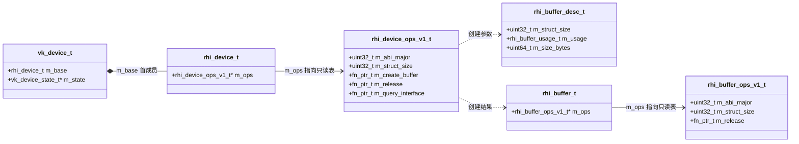

# DragonFly RHI 接口与 ABI

本文定义公共 C 接口、对象分派、C++23 模块重导出和调用契约。声明草案按当前 DragonFly/public、public_core.h 与 public_api 模块组织；当前代码仍是 drawable 演示，尚未实现以下 RHI。风格依据见 [代码与文档约定](code-style.md)，组件边界、部署与帧调度见 [网格编辑器与 RHI 架构](rhi-architecture.md)。

- [命名规则](#命名规则)
- [C ABI 与对象分派](#c-abi-与对象分派)
- [C++23 模块](#c23-模块)
- [实例、适配器与资源入口](#实例适配器与资源入口)
- [设备能力与描述符多态](#设备能力与描述符多态)
- [命令池、命令列表与队列](#命令池命令列表与队列)
- [显式屏障和资源流转](#显式屏障和资源流转)
- [资源上传、绘制和度量入口](#资源上传绘制和度量入口)
- [渲染附件与精度约定](#渲染附件与精度约定)
- [窗口与呈现](#窗口与呈现)
- [接口验收](#接口验收)

## 命名规则

| 对象 | 规则 | 示例 |
| --- | --- | --- |
| 函数、局部变量、参数 | 小写加下划线，公开 C 函数带 `rhi_` | `rhi_device_create_buffer`、`out_buffer` |
| 结构体、类、类型别名 | 小写加下划线，以 `_t` 结尾，公开 C 类型带 `rhi_` | `rhi_device_t`、`vk_device_t`、`rhi_result_t` |
| 非静态数据成员 | `m_` 前缀，覆盖 C 结构体字段和函数表槽位 | `m_size_bytes`、`m_ops`、`m_create_buffer` |
| C++ 静态数据成员 | `s_` 前缀 | `s_instance_count` |
| 全局变量 | `g_` 前缀，优先留在实现文件并使用内部链接 | `g_vk_device_ops` |
| 宏、枚举常量 | 大写加下划线，复用项目公共宏 | `DRAGONFLY_EXPORT_SYMBOL`、`CONTAINER_OF`、`RHI_OK` |

公开 C 结构体以同名 `typedef` 提供类型名，调用方可以写 `rhi_device_t *device`。函数指针别名在文件作用域声明并以 `_t` 结尾。C++ 模块按原名在全局作用域重导出。公用状态通过对象和函数访问，尽量避免导出全局数据符号。

代码块统一采用两个空格缩进，类型定义的左花括号独立成行，字段每行一个，指针星号靠近变量名。节选均注明拟归属头文件；后续节选属于同一头文件的声明片段，应放在其 include guard 与 `BEGIN_EXTERN_C` / `END_EXTERN_C` 范围内，不能逐块当作独立完整头文件。

## C ABI 与对象分派

拟新增的 `DragonFly/public/public_rhi.h` 声明设备、缓冲等句柄类型、描述符和常规函数。需要直接调用函数表或实现对象协议的代码额外包含 `public_rhi_iface.h`。普通入口 `rhi_device_create_buffer(device, desc, out_buffer)` 与直接调用 `device->m_ops->m_create_buffer(device, desc, out_buffer)` 使用同一创建契约。

### 核心头文件

以下是 `Device → Buffer` 的声明切片。沿用 `public_core.h` 的 `DRAGONFLY_EXPORT_SYMBOL`、`BEGIN_EXTERN_C` 与 `END_EXTERN_C`；函数与函数表槽位采用统一的目标平台默认 C 调用约定。`public_api.h` 计划汇总 `public_rhi.h` 和 `public_rhi_wsi.h`，函数表布局由调用方按需包含 `public_rhi_iface.h`。

```c
/* public_rhi.h */
#ifndef DRAGONFLY_PUBLIC_RHI_H
#define DRAGONFLY_PUBLIC_RHI_H

#include "public_core.h"

BEGIN_EXTERN_C

typedef struct rhi_device_t rhi_device_t;
typedef struct rhi_buffer_t rhi_buffer_t;
typedef int32_t rhi_result_t;
typedef uint32_t rhi_buffer_usage_t;

enum
{
  RHI_ABI_MAJOR_V1 = 1
};

enum
{
  RHI_OK = 0,
  RHI_NOT_READY = 1,
  RHI_TIMEOUT = 2,
  RHI_ERROR_INVALID_ARGUMENT = -1,
  RHI_ERROR_UNSUPPORTED = -2,
  RHI_ERROR_OUT_OF_MEMORY = -3,
  RHI_ERROR_DEVICE_LOST = -4
};

enum
{
  RHI_BUFFER_COPY_SRC = 1u << 0,
  RHI_BUFFER_COPY_DST = 1u << 1,
  RHI_BUFFER_VERTEX = 1u << 2
};

typedef struct rhi_buffer_desc_t
{
  uint32_t m_struct_size;
  rhi_buffer_usage_t m_usage;
  uint64_t m_size_bytes;
} rhi_buffer_desc_t;

DRAGONFLY_EXPORT_SYMBOL rhi_result_t rhi_device_create_buffer(
  rhi_device_t *device,
  const rhi_buffer_desc_t *desc,
  rhi_buffer_t **out_buffer);

DRAGONFLY_EXPORT_SYMBOL rhi_result_t rhi_device_query_interface(
  rhi_device_t *device,
  uint32_t interface_id,
  uint32_t interface_version,
  const void **out_table);

DRAGONFLY_EXPORT_SYMBOL void rhi_buffer_release(rhi_buffer_t *buffer);
DRAGONFLY_EXPORT_SYMBOL void rhi_device_release(rhi_device_t *device);

END_EXTERN_C

#endif
```

### 函数表头文件

```c
/* public_rhi_iface.h */
#ifndef DRAGONFLY_PUBLIC_RHI_IFACE_H
#define DRAGONFLY_PUBLIC_RHI_IFACE_H

#include "public_rhi.h"

BEGIN_EXTERN_C

typedef struct rhi_device_ops_v1_t
{
  uint32_t m_abi_major;
  uint32_t m_struct_size;

  rhi_result_t (*m_create_buffer)(
    rhi_device_t *self,
    const rhi_buffer_desc_t *desc,
    rhi_buffer_t **out_buffer);

  void (*m_release)(rhi_device_t *self);

  rhi_result_t (*m_query_interface)(
    rhi_device_t *self,
    uint32_t interface_id,
    uint32_t interface_version,
    const void **out_table);
} rhi_device_ops_v1_t;

typedef struct rhi_buffer_ops_v1_t
{
  uint32_t m_abi_major;
  uint32_t m_struct_size;

  void (*m_release)(rhi_buffer_t *self);
} rhi_buffer_ops_v1_t;

struct rhi_device_t
{
  const rhi_device_ops_v1_t *m_ops;
};

struct rhi_buffer_t
{
  const rhi_buffer_ops_v1_t *m_ops;
};

END_EXTERN_C

#endif
```

### UML 类图

实心菱形表示实现对象内嵌公开对象前缀，普通箭头表示前缀指向函数表，虚线表示操作依赖。函数表的槽位以函数指针数据成员列出，图中的 fn_ptr_t 仅为函数指针类型的示意标记。



C 测试替身使用与项目一致的 `CONTAINER_OF(TYPE, ptr, member)` 参数顺序。先检查真实对象类型和首成员布局，再恢复外壳；宏本身不做运行时类型识别。

```c
/* C 测试替身；不是新增公共类型。 */
typedef struct mock_device_t
{
  rhi_device_t m_base;
  void *m_state;
} mock_device_t;

_Static_assert(
  OFFSET_OF(mock_device_t, m_base) == 0,
  "m_base must be the first member");
```

回调中的恢复表达式为 `CONTAINER_OF(mock_device_t, self, m_base)`，其中 self 必须来自对应对象的 m_base。

C++ 后端采用同样的首成员外壳，把复杂实现间接放入 m_state。以下约束在实际后端编译时检查：

```cpp
/* DragonFly/private/rhi/vulkan/ 下的实现约束；不是公共 ABI 定义。 */
class vk_device_state_t;

struct vk_device_t
{
  rhi_device_t m_base;
  vk_device_state_t *m_state;
};

static_assert(std::is_standard_layout_v<vk_device_t>);
static_assert(OFFSET_OF(vk_device_t, m_base) == 0);
```

实现文件沿用 `import public_api;`、`import std;` 并包含 `public_core.h` 取得宏。槽位回调置于 `BEGIN_EXTERN_C` / `END_EXTERN_C` 中，采用与声明一致的调用约定。C++ 回调通过 `reinterpret_cast<vk_device_t *>(self)` 直接恢复经过检查、与首成员指针可互转换的外壳；C 测试替身使用前面的 `CONTAINER_OF` 形式。该约定不扩展到任意非首成员、C++ 继承层级或未知类型指针。[C 首成员转换规则](https://www.open-std.org/jtc1/sc22/WG14/www/docs/n1570.pdf) · [C++ 指针可互转换规则](https://eel.is/c++draft/basic.compound)

`OFFSET_OF` 和 `CONTAINER_OF` 只在 `public_core.h` 定义。下面展示当前实现形式，功能头文件不重复定义；RHI 调用仍额外遵守偏移为零的限制：

```c
/* public_core.h — 当前公共宏，依赖 <stddef.h>。 */
#define OFFSET_OF(TYPE, member) offsetof(TYPE, member)

#define CONTAINER_OF(TYPE, ptr, member) \
  ((TYPE *)((unsigned char *)(ptr) - OFFSET_OF(TYPE, member)))
```

### 布局与版本

- C 导出函数包在 `BEGIN_EXTERN_C` / `END_EXTERN_C` 中并使用 `DRAGONFLY_EXPORT_SYMBOL`。导出函数和槽位使用一致的目标平台默认 C 调用约定，生产端与消费端不得单独用编译选项改变它；需要新调用约定时统一扩展 `public_core.h`。入口和回调在 ABI 边界内处理 C++ 异常。
- ABI 字段使用定宽整数、指针和约定布局的结构体。枚举项提供常量，传参和存储使用明确的定宽类型。按目标平台约定调用约定、自然对齐和 ABI 兼容范围。
- 对象由提供方创建和释放。消费者只读 `m_ops`，函数表在对象存活期间有效。消费者通过提供方接口分配对象，公开前缀只描述分派所需的布局。
- 入口 `rhi_create_instance` 接收调用方要求的 ABI 主版本。V1 发布后固定描述符、对象前缀和函数表布局，描述符的 `m_struct_size` 填对应类型的 `sizeof`，表由提供方填主版本和表大小。
- `rhi_device_query_interface` 通过 V1 的 `m_query_interface` 按接口 ID 和版本获取独立函数表。返回值是借用的只读表，有效期以设备为界。未知组合返回 `RHI_ERROR_UNSUPPORTED` 并将有效的输出地址置空。新增操作可由新 C 符号包装这些槽位。
- 创建操作成功时写出一个拥有的句柄。失败时若输出地址有效，则将输出句柄置空。两条调用路径都遵守这项约定。

### CPU 句柄与 GPU 生命周期

- 创建成功返回拥有句柄，由同一提供方的 `release` 回收。队列句柄借用自设备，交换链图像借用自当帧票据。应用先释放子对象，再释放设备。
- 描述符、数组等输入默认只需在调用期间有效。录制阶段由命令列表保活其引用的普通资源。提交成功后，由后端保活提交依赖直至 GPU 完成。

## C++23 模块

沿用现有 `DragonFly/public/public_api.cppm` 与 `public_api` 模块名。全局模块片段包含汇总头文件及需要导出的函数表头文件，再用 `export {` 中逐行的 `using ::名称;` 重导出全局原名。头文件和模块调用链接同一组 C 导出符号；宏仍通过头文件使用。

下面保留当前 drawable 演示的导出，展示新增 Device → Buffer 切片的计划接入方式。前提是 `public_api.h` 已汇总新增 RHI 头文件；当前仓库尚未完成这些声明的实际接入。

```cpp
module;

#include "public_api.h"
#include "public_rhi_iface.h"

export module public_api;

export {
  using ::draw_function_t;
  using ::drawable_base_t;
  using ::triangle_t;
  using ::rectangle_t;
  using ::circle_t;

  using ::create_triangle;
  using ::create_rectangle;
  using ::create_circle;
  using ::destroy_triangle;
  using ::destroy_rectangle;
  using ::destroy_circle;

  using ::rhi_device_t;
  using ::rhi_buffer_t;
  using ::rhi_result_t;
  using ::rhi_buffer_usage_t;
  using ::rhi_buffer_desc_t;
  using ::rhi_device_ops_v1_t;
  using ::rhi_buffer_ops_v1_t;

  using ::RHI_ABI_MAJOR_V1;
  using ::RHI_OK;
  using ::RHI_NOT_READY;
  using ::RHI_TIMEOUT;
  using ::RHI_ERROR_INVALID_ARGUMENT;
  using ::RHI_ERROR_UNSUPPORTED;
  using ::RHI_ERROR_OUT_OF_MEMORY;
  using ::RHI_ERROR_DEVICE_LOST;
  using ::RHI_BUFFER_COPY_SRC;
  using ::RHI_BUFFER_COPY_DST;
  using ::RHI_BUFFER_VERTEX;

  using ::rhi_device_create_buffer;
  using ::rhi_device_query_interface;
  using ::rhi_buffer_release;
  using ::rhi_device_release;
}
```

命令、同步和 `public_rhi_wsi.h` 的声明按相同方式逐项补齐，不另引入模块内的包装类型。SandBox 继续使用 `import public_api;`，C 调用方使用 `#include "public_api.h"` 或所需的具体头文件。

分发模块源文件并由匹配的消费工具链构建 BMI，编译器、标准库、目标平台和宏条件分别验证。C ABI 是库的二进制兼容边界，模块名称并不自动提供跨工具链二进制兼容。 [C++ 模块接口规则](https://eel.is/c++draft/module.interface) · [Clang 的重导出示例](https://clang.llvm.org/docs/StandardCPlusPlusModules.html#export-using-style)

## 实例、适配器与资源入口

| 对象 | 代表性入口 | 接口语义 |
| --- | --- | --- |
| 实例与适配器 | `rhi_create_instance`、`rhi_instance_enumerate_adapters`、`rhi_adapter_get_caps`、`rhi_adapter_create_device` | 实例创建时声明 ABI 主版本和需要接入的窗口类型。设备创建时声明必需特性。 |
| 设备与资源 | `rhi_device_get_queue`、`rhi_device_create_buffer`、`rhi_device_create_texture`、`rhi_device_create_texture_view`、`rhi_device_create_sampler` | 描述符定义尺寸、格式和用途。视图与资源及引用它们的命令属于同一设备。 |
| 管线与绑定 | `rhi_device_create_shader_module`、`rhi_device_create_bind_group_layout`、`rhi_device_create_bind_group`、`rhi_device_create_graphics_pipeline` | 着色器输入带格式标签，首版支持 SPIR-V。后端把 RHI 的绑定布局映射为 Vulkan 描述符布局。 |

## 设备能力与描述符多态

适配器查询区分**支持能力**、**请求能力**和**设备实际启用能力**。创建设备时，缺少必需能力返回 `RHI_ERROR_UNSUPPORTED`。可选能力允许按设备回退，调用者通过设备查询确认最终启用集合。图像能力按格式、维度、用途和采样数的组合查询，Surface 能力另外按适配器和窗口查询。

```c
/* public_rhi.h — 设备描述符节选 */
typedef struct rhi_surface_t rhi_surface_t;
typedef uint64_t rhi_device_features_t;
typedef uint32_t rhi_queue_roles_t;

enum
{
  RHI_DEVICE_FEATURE_SECONDARY_RENDER = 1u << 0,
  RHI_DEVICE_FEATURE_GPU_TIMESTAMPS = 1u << 1
};

enum
{
  RHI_QUEUE_ROLE_GRAPHICS = 1u << 0,
  RHI_QUEUE_ROLE_COMPUTE = 1u << 1,
  RHI_QUEUE_ROLE_TRANSFER = 1u << 2
};

enum
{
  RHI_EXTENSION_DEVICE_QUEUES = 1
};

typedef struct rhi_extension_desc_t rhi_extension_desc_t;

struct rhi_extension_desc_t
{
  uint32_t m_type;
  uint32_t m_struct_size;
  const rhi_extension_desc_t *m_next;
};

typedef struct rhi_device_queues_ext_v1_t
{
  rhi_extension_desc_t m_base;
  rhi_queue_roles_t m_required_roles;
  rhi_queue_roles_t m_optional_roles;
} rhi_device_queues_ext_v1_t;

typedef struct rhi_device_desc_t
{
  uint32_t m_struct_size;
  rhi_device_features_t m_required_features;
  rhi_device_features_t m_optional_features;
  rhi_surface_t *m_present_surface;
  const rhi_extension_desc_t *m_next;
} rhi_device_desc_t;
```

应用把 `&queue_request.m_base` 放进 `rhi_device_desc_t.m_next`。接收方先校验标签、结构大小和允许的挂接位置，再根据 `m_type` 恢复相应首成员外壳。该扩展为 compute 和 transfer 各请求最多一条额外的独立提交队列，必需和可选角色掩码互斥。角色查询每次传一个角色。未启用的角色查询返回 `RHI_ERROR_UNSUPPORTED`。`m_present_surface` 为空时创建设备用于离屏。

扩展链仅用于创建设备等低频描述符。链以空指针结束，重复标签、成环和结构大小不匹配属于无效参数。未知标签返回 `RHI_ERROR_UNSUPPORTED`，避免调用者依赖的语义被默默丢弃。节点内存和嵌套输入在调用期间有效。首成员转换建立在调用者提供真实、可读的对应结构体这一 ABI 前提上。

## 命令池、命令列表与队列

```c
/* public_rhi.h — 命令和队列类型 */
typedef struct rhi_command_pool_t rhi_command_pool_t;
typedef struct rhi_command_list_t rhi_command_list_t;
typedef struct rhi_queue_t rhi_queue_t;
typedef struct rhi_frame_ticket_t rhi_frame_ticket_t;
typedef struct rhi_render_signature_t rhi_render_signature_t;

typedef uint64_t rhi_pipeline_stages_t;

typedef struct rhi_queue_info_t
{
  uint32_t m_struct_size;
  rhi_queue_roles_t m_roles;
  uint32_t m_family_id;
  uint32_t m_timestamp_valid_bits;
} rhi_queue_info_t;

typedef struct rhi_queue_point_t
{
  rhi_queue_t *m_queue;
  uint64_t m_value;
} rhi_queue_point_t;

typedef struct rhi_queue_wait_desc_t
{
  rhi_queue_point_t m_point;
  rhi_pipeline_stages_t m_dst_stages;
} rhi_queue_wait_desc_t;

typedef struct rhi_submit_desc_t
{
  uint32_t m_struct_size;
  uint32_t m_command_list_count;
  rhi_command_list_t *const *m_command_lists;
  uint32_t m_wait_count;
  const rhi_queue_wait_desc_t *m_waits;
  const rhi_frame_ticket_t *m_frame_ticket;
  rhi_pipeline_stages_t m_frame_wait_stages;
} rhi_submit_desc_t;

DRAGONFLY_EXPORT_SYMBOL rhi_result_t rhi_device_get_queue(
  rhi_device_t *device, rhi_queue_t **out_queue);
DRAGONFLY_EXPORT_SYMBOL rhi_result_t rhi_device_get_queue_for_role(
  rhi_device_t *device, rhi_queue_roles_t role, rhi_queue_t **out_queue);
DRAGONFLY_EXPORT_SYMBOL rhi_result_t rhi_device_create_command_pool(
  rhi_device_t *device, rhi_queue_t *queue, rhi_command_pool_t **out_pool);

DRAGONFLY_EXPORT_SYMBOL rhi_result_t rhi_command_pool_alloc(
  rhi_command_pool_t *pool, uint32_t count, rhi_command_list_t **out_lists);
DRAGONFLY_EXPORT_SYMBOL rhi_result_t rhi_command_pool_reset(rhi_command_pool_t *pool);
DRAGONFLY_EXPORT_SYMBOL void rhi_command_pool_release(rhi_command_pool_t *pool);

DRAGONFLY_EXPORT_SYMBOL rhi_result_t rhi_cmd_begin(rhi_command_list_t *cmd);
DRAGONFLY_EXPORT_SYMBOL rhi_result_t rhi_cmd_begin_secondary_render(
  rhi_command_list_t *cmd, const rhi_render_signature_t *signature);
DRAGONFLY_EXPORT_SYMBOL void rhi_cmd_execute_secondary(
  rhi_command_list_t *cmd, uint32_t count, rhi_command_list_t *const *lists);
DRAGONFLY_EXPORT_SYMBOL rhi_result_t rhi_cmd_end(rhi_command_list_t *cmd);

DRAGONFLY_EXPORT_SYMBOL rhi_result_t rhi_queue_get_info(
  rhi_queue_t *queue, rhi_queue_info_t *out_info);
DRAGONFLY_EXPORT_SYMBOL rhi_result_t rhi_queue_submit(
  rhi_queue_t *queue, const rhi_submit_desc_t *desc, uint64_t *out_value);
DRAGONFLY_EXPORT_SYMBOL rhi_result_t rhi_queue_get_completed_value(
  rhi_queue_t *queue, uint64_t *out_value);
DRAGONFLY_EXPORT_SYMBOL rhi_result_t rhi_queue_wait(
  rhi_queue_t *queue, uint64_t value, uint64_t timeout_ns);
```

### 录制与复用

- 调用方串行化同一命令池的分配、录制和重置。使用独立命令池的列表可以并行录制。
- 命令池绑定到同设备的目标队列。列表由池持有，句柄借用至池释放。批量分配成功时写满输出数组，失败时不交付部分列表。列表依次进入初始、录制、可提交和在途状态。V1 每次录制只允许进入一次提交，池重置后可重新录制。
- 启用 `RHI_DEVICE_FEATURE_SECONDARY_RENDER` 后，主列表可引用同队列上独立命令池录制的二级列表。主列表录制线程读取二级列表前，调用方须完成二级录制并建立线程间同步。主列表按数组顺序执行二级列表，每份二级录制只关联一个主列表的一次执行。渲染区域在主列表统一设置附件、加载和清理，二级列表按格式、采样数和视图掩码匹配，并自行设置管线、绑定与动态状态。[Vulkan 动态渲染继承信息](https://docs.vulkan.org/refpages/latest/refpages/source/VkCommandBufferInheritanceRenderingInfo.html)
- `rhi_command_pool_reset` 不等待 GPU。池内有在途列表，或二级列表仍被有效主列表引用时，返回 `RHI_NOT_READY` 并保留现有状态。帧槽复用时，先确认有关队列完成，再重置主列表所在池和二级列表所在池。调用者停止访问后可释放池，后端延迟回收被提交引用的内部对象。[Vulkan 命令缓冲生命周期](https://docs.vulkan.org/spec/latest/chapters/cmdbuffers.html#commandbuffers-lifecycle)
- 热路径 `void` 录制命令的前置条件由 API 定义。可恢复的录制故障由后端记在列表上，通过 `rhi_cmd_end` 报告，失败列表只能重置或释放。调试后端可额外记录参数和状态诊断。

### 提交、完成与等待

- 提交一个非空的有序主列表数组，返回该队列的一个非零完成值。完成值以**队列和值**成对保存。不同队列的值各自递增。调用方串行化同一队列上的提交与呈现。提交成功会登记资源保活和票据使用。参数校验失败时，列表和票据保持原状态。
- `m_waits` 引用同设备其他队列上**已经成功提交**的完成点。每项指定消费者需要同步的阶段范围。提交调用无需等待这些 GPU 完成点，消费者队列处理依赖。同队列上用屏障表达资源访问依赖。V1 只接受已有的完成点，调用者按生产者先提交、消费者后提交组织批次。[Vulkan 同步规范](https://docs.vulkan.org/spec/latest/chapters/synchronization.html#synchronization-semaphores)
- `m_frame_ticket` 为空时提交不关联呈现，`m_frame_wait_stages` 为零。带票据时，阶段范围覆盖交换链图像的首次访问和相应布局转换。后端单独处理 WSI 的 acquire/present 同步，队列完成值仍用于 GPU 工作回收。
- `rhi_queue_get_completed_value` 只查询进度。`rhi_queue_wait` 以纳秒指定上限，零表示轮询，超时返回 `RHI_TIMEOUT`。
- 成功提交后失去设备时，等待和查询返回 `RHI_ERROR_DEVICE_LOST`。调用者终止该设备的调度并释放设备资源，完成值仍属于原设备。

### 命令对象函数表

`rhi_device_query_interface(device, RHI_DEVICE_INTERFACE_COMMANDS, 1, &table)` 获取命令工厂表。实现方以设备作为 `self`，提供默认队列查询、额外队列查询和命令池工厂。调用者用 `const void *table` 接收后转换成 `const rhi_device_command_ops_v1_t *`。该表是基线命令路径的一部分，额外队列槽位在角色未启用时返回 `RHI_ERROR_UNSUPPORTED`。

```c
/* public_rhi_iface.h — 命令对象多态切片 */
enum
{
  RHI_DEVICE_INTERFACE_COMMANDS = 1
};

typedef struct rhi_device_command_ops_v1_t
{
  uint32_t m_abi_major;
  uint32_t m_struct_size;
  rhi_result_t (*m_get_queue_for_role)(
    rhi_device_t *self, rhi_queue_roles_t role, rhi_queue_t **out_queue);
  rhi_result_t (*m_create_command_pool)(
    rhi_device_t *self, rhi_queue_t *queue, rhi_command_pool_t **out_pool);
} rhi_device_command_ops_v1_t;

typedef struct rhi_queue_ops_v1_t
{
  uint32_t m_abi_major;
  uint32_t m_struct_size;
  rhi_result_t (*m_get_info)(rhi_queue_t *self, rhi_queue_info_t *out_info);
  rhi_result_t (*m_submit)(
    rhi_queue_t *self, const rhi_submit_desc_t *desc, uint64_t *out_value);
  rhi_result_t (*m_get_completed_value)(rhi_queue_t *self, uint64_t *out_value);
  rhi_result_t (*m_wait)(rhi_queue_t *self, uint64_t value, uint64_t timeout_ns);
} rhi_queue_ops_v1_t;

typedef struct rhi_command_pool_ops_v1_t
{
  uint32_t m_abi_major;
  uint32_t m_struct_size;
  rhi_result_t (*m_alloc)(
    rhi_command_pool_t *self, uint32_t count, rhi_command_list_t **out_lists);
  rhi_result_t (*m_reset)(rhi_command_pool_t *self);
  void (*m_release)(rhi_command_pool_t *self);
} rhi_command_pool_ops_v1_t;

struct rhi_queue_t
{
  const rhi_queue_ops_v1_t *m_ops;
};
struct rhi_command_pool_t
{
  const rhi_command_pool_ops_v1_t *m_ops;
};
```

普通 C 入口和直接槽位遵循同一契约。`rhi_device_get_queue` 使用命令工厂的 graphics 角色，队列句柄借用至设备释放。后端可把 `rhi_queue_t m_base` 嵌入 `vk_queue_t` 首位，回调从 `self` 恢复实现对象。C 测试替身可使用同样的布局和 `CONTAINER_OF`。命令录制入口使用不透明的 `rhi_command_list_t`。

## 显式屏障和资源流转

```c
/* public_rhi.h — 批量屏障的结构 */
typedef struct rhi_texture_t rhi_texture_t;
typedef uint64_t rhi_access_flags_t;
typedef uint32_t rhi_texture_layout_t;
typedef uint32_t rhi_queue_transfer_phase_t;

enum
{
  RHI_QUEUE_TRANSFER_NONE = 0,
  RHI_QUEUE_TRANSFER_RELEASE = 1,
  RHI_QUEUE_TRANSFER_ACQUIRE = 2
};

typedef struct rhi_access_scope_t
{
  rhi_pipeline_stages_t m_stages;
  rhi_access_flags_t m_access;
} rhi_access_scope_t;

typedef struct rhi_queue_transfer_t
{
  rhi_queue_transfer_phase_t m_phase;
  rhi_queue_t *m_src_queue;
  rhi_queue_t *m_dst_queue;
} rhi_queue_transfer_t;

typedef struct rhi_texture_subresource_range_t
{
  uint32_t m_aspects;
  uint32_t m_base_mip;
  uint32_t m_mip_count;
  uint32_t m_base_layer;
  uint32_t m_layer_count;
} rhi_texture_subresource_range_t;

typedef struct rhi_memory_barrier_t
{
  rhi_access_scope_t m_src;
  rhi_access_scope_t m_dst;
} rhi_memory_barrier_t;

typedef struct rhi_buffer_barrier_t
{
  rhi_buffer_t *m_buffer;
  uint64_t m_offset_bytes;
  uint64_t m_size_bytes;
  rhi_memory_barrier_t m_scopes;
  rhi_queue_transfer_t m_transfer;
} rhi_buffer_barrier_t;

typedef struct rhi_texture_barrier_t
{
  rhi_texture_t *m_texture;
  rhi_texture_subresource_range_t m_range;
  rhi_texture_layout_t m_old_layout;
  rhi_texture_layout_t m_new_layout;
  rhi_memory_barrier_t m_scopes;
  rhi_queue_transfer_t m_transfer;
} rhi_texture_barrier_t;

typedef struct rhi_dependency_desc_t
{
  uint32_t m_struct_size;
  uint32_t m_memory_count;
  const rhi_memory_barrier_t *m_memory;
  uint32_t m_buffer_count;
  const rhi_buffer_barrier_t *m_buffers;
  uint32_t m_texture_count;
  const rhi_texture_barrier_t *m_textures;
} rhi_dependency_desc_t;

DRAGONFLY_EXPORT_SYMBOL void rhi_cmd_barrier(
  rhi_command_list_t *cmd, const rhi_dependency_desc_t *desc);
```

常规屏障的转移阶段为 `NONE`，队列字段置空。跨队列时，生产者提交返回完成点，消费者提交等待该点。跨队列族独占资源还需要源列表的 `RELEASE` 与目标列表的 `ACQUIRE`，双方匹配资源、子范围、队列和布局转换，release 的目标访问域与 acquire 的源访问域置空。同队列族的两个队列仍可能需要完成点依赖，纹理布局变化由显式屏障表达。队列族标识仅在设备内比较，WSI 的原生呈现队列由后端处理。[Khronos 同步示例](https://docs.vulkan.org/guide/latest/synchronization_examples.html)

纹理上传后的屏障按首次采样的访问范围同步。即使前后布局相同，写入后读取仍需正确的内存依赖。屏障可以批量提交，数组数量为零时对应指针可以为空。

## 资源上传、绘制和度量入口

| 领域 | 计划入口 | 接口约束 |
| --- | --- | --- |
| 能力 | `rhi_adapter_get_format_caps`、`rhi_adapter_get_limits`、`rhi_device_get_enabled_features` | 返回格式用途、采样数、对齐、尺寸、队列能力和实际启用功能。由调用者决定可接受的回退。 |
| 上传和读回 | `rhi_buffer_map_range`、`rhi_buffer_unmap`、`rhi_buffer_flush_range`、`rhi_buffer_invalidate_range` | 用扩展创建入口指定 GPU、上传或读回内存用途。支持时允许持久映射。调用方提交前写完并 flush 非一致内存，读回前等完成并 invalidate。回收分段按关联完成点处理。 |
| Copy | `rhi_cmd_copy_buffer`、`rhi_cmd_copy_buffer_to_texture`、`rhi_cmd_copy_texture_to_buffer`、`rhi_cmd_copy_texture` | 批量 region 明确偏移、行跨度、层、mip 和 aspect，校验格式块大小与对齐。 |
| 资源绑定 | `rhi_device_create_pipeline_layout`、`rhi_device_create_bind_group`、`rhi_cmd_bind_groups`、`rhi_cmd_push_constants` | 绑定布局明确资源类型、数组长度、可见阶段和动态偏移。默认用不可变 bind group，更新时创建新对象并保活旧版本。 |
| 图形录制 | `rhi_cmd_begin_rendering`、`rhi_cmd_set_viewports`、`rhi_cmd_set_scissors`、`rhi_cmd_bind_graphics_pipeline`、`rhi_cmd_bind_vertex_buffers`、`rhi_cmd_bind_index_buffer`、`rhi_cmd_draw_indexed` | 批量设置数组状态，索引类型与偏移显式。附件格式、resolve 和采样数与管线匹配。 |
| GPU 生成工作 | `rhi_device_create_compute_pipeline`、`rhi_cmd_bind_compute_pipeline`、`rhi_cmd_dispatch`、`rhi_cmd_draw_indexed_indirect` | 间接参数和布局明确。compute 写入间接参数后，消费者按间接读取同步。indirect count、bindless 和专用异步队列按能力启用。 |
| 管线准备 | `rhi_device_create_pipeline_cache`、`rhi_pipeline_cache_get_data` | 公开缓存数据为不透明字节，按后端兼容标识区分设备和驱动。共享缓存的并发规则在接口中明示。 |
| 诊断和计时 | `rhi_device_create_query_pool`、`rhi_cmd_reset_queries`、`rhi_cmd_write_timestamp`、`rhi_query_pool_try_read`、`rhi_cmd_begin_debug_label`、`rhi_cmd_end_debug_label` | 延迟读取，每项返回可用标记。报告时间单位和有效位，处理计数回绕。跨队列时钟比较依赖校准能力。[Vulkan timestamp 规则](https://docs.vulkan.org/spec/latest/chapters/queries.html#queries-timestamps) |

调用者须等到关联的 GPU 读取完成，才能改写上传区内对应的范围。对非一致内存，相邻分段还要遵守设备报告的缓存维护粒度。上传、读回和 staging 的同步围绕使用这些字节的提交完成点安排。

```c
/* public_rhi.h — 可映射缓冲创建与访问 */
typedef uint32_t rhi_memory_usage_t;
typedef uint32_t rhi_map_access_t;

enum
{
  RHI_MEMORY_DEVICE = 1,
  RHI_MEMORY_UPLOAD = 2,
  RHI_MEMORY_READBACK = 3
};

enum
{
  RHI_MAP_READ = 1u << 0,
  RHI_MAP_WRITE = 1u << 1
};

typedef struct rhi_buffer_memory_desc_v1_t
{
  uint32_t m_struct_size;
  rhi_buffer_usage_t m_usage;
  uint64_t m_size_bytes;
  rhi_memory_usage_t m_memory_usage;
} rhi_buffer_memory_desc_v1_t;

DRAGONFLY_EXPORT_SYMBOL rhi_result_t rhi_device_create_buffer_with_memory(
  rhi_device_t *device, const rhi_buffer_memory_desc_v1_t *desc,
  rhi_buffer_t **out_buffer);
DRAGONFLY_EXPORT_SYMBOL rhi_result_t rhi_buffer_map_range(
  rhi_buffer_t *buffer, uint64_t offset_bytes, uint64_t size_bytes,
  rhi_map_access_t access, void **out_data);
DRAGONFLY_EXPORT_SYMBOL rhi_result_t rhi_buffer_flush_range(
  rhi_buffer_t *buffer, uint64_t offset_bytes, uint64_t size_bytes);
DRAGONFLY_EXPORT_SYMBOL rhi_result_t rhi_buffer_invalidate_range(
  rhi_buffer_t *buffer, uint64_t offset_bytes, uint64_t size_bytes);
DRAGONFLY_EXPORT_SYMBOL void rhi_buffer_unmap(rhi_buffer_t *buffer);
```

基线 `rhi_device_create_buffer` 对应 GPU 资源用途。每个缓冲在同一时间最多有一个活动映射，映射指针可保持至 unmap 或缓冲释放，便于一次映射、按区间复用。flush 和 invalidate 的偏移均相对缓冲起点，区间必须落在活动映射内。这些入口不等待 GPU，访问区间的同步由调用者负责。

## 渲染附件与精度约定

```c
/* public_rhi.h — 渲染兼容签名及带标签的清除值 */
typedef uint32_t rhi_format_t;
typedef uint32_t rhi_clear_kind_t;

enum
{
  RHI_CLEAR_FLOAT32 = 1,
  RHI_CLEAR_SINT32 = 2,
  RHI_CLEAR_UINT32 = 3,
  RHI_CLEAR_DEPTH_STENCIL = 4
};

struct rhi_render_signature_t
{
  uint32_t m_struct_size;
  uint32_t m_color_count;
  const rhi_format_t *m_color_formats;
  rhi_format_t m_depth_format;
  rhi_format_t m_stencil_format;
  uint32_t m_sample_count;
  uint32_t m_view_mask;
};

typedef struct rhi_clear_depth_stencil_t
{
  float m_depth;
  uint32_t m_stencil;
} rhi_clear_depth_stencil_t;

typedef union rhi_clear_payload_t
{
  float m_float32[4];
  int32_t m_sint32[4];
  uint32_t m_uint32[4];
  rhi_clear_depth_stencil_t m_depth_stencil;
} rhi_clear_payload_t;

typedef struct rhi_clear_value_t
{
  rhi_clear_kind_t m_kind;
  rhi_clear_payload_t m_value;
} rhi_clear_value_t;

typedef struct rhi_texture_view_t rhi_texture_view_t;
typedef uint32_t rhi_load_op_t;
typedef uint32_t rhi_store_op_t;
typedef uint32_t rhi_resolve_mode_t;
typedef uint32_t rhi_render_contents_t;

enum
{
  RHI_RENDER_CONTENTS_INLINE = 0,
  RHI_RENDER_CONTENTS_SECONDARY = 1
};

typedef struct rhi_render_attachment_t
{
  rhi_texture_view_t *m_view;
  rhi_texture_view_t *m_resolve_view;
  rhi_texture_layout_t m_layout;
  rhi_texture_layout_t m_resolve_layout;
  rhi_load_op_t m_load_op;
  rhi_store_op_t m_store_op;
  rhi_resolve_mode_t m_resolve_mode;
  rhi_clear_value_t m_clear_value;
} rhi_render_attachment_t;

typedef struct rhi_rendering_desc_t
{
  uint32_t m_struct_size;
  const rhi_render_signature_t *m_signature;
  rhi_render_contents_t m_contents;
  uint32_t m_offset_x;
  uint32_t m_offset_y;
  uint32_t m_width;
  uint32_t m_height;
  uint32_t m_layer_count;
  const rhi_render_attachment_t *m_colors;
  const rhi_render_attachment_t *m_depth;
  const rhi_render_attachment_t *m_stencil;
} rhi_rendering_desc_t;

DRAGONFLY_EXPORT_SYMBOL void rhi_cmd_begin_rendering(
  rhi_command_list_t *cmd, const rhi_rendering_desc_t *desc);
DRAGONFLY_EXPORT_SYMBOL void rhi_cmd_end_rendering(rhi_command_list_t *cmd);
```

`m_colors` 的元素数由签名的 `m_color_count` 指定，深度与模板指针按需要提供。附件视图在开始录制渲染区域前进入描述符声明的布局，清除值只在加载操作为清除时使用。开启多视图时，`m_view_mask` 决定参与的视图，普通多层渲染由 `m_layer_count` 指定。

- **格式和色彩**。描述符分别定义纹理存储格式、视图格式和交换链输出色彩空间。视图格式定义 sRGB 编解码行为，渲染管线使用线性色值。HDR 输出使用 Surface 报告的格式与色彩空间组合。[Vulkan 图像格式](https://docs.vulkan.org/spec/latest/chapters/formats.html) · [帧缓冲混合和 sRGB 编码](https://docs.vulkan.org/spec/latest/chapters/framebuffer.html)
- **附件和管线**。渲染描述符逐附件指定视图、加载、保存、清除与 resolve。整数附件清除使用匹配的整数成员。深度和模板分别明确比较、写掩码与清除值。请求的采样数或 resolve 模式不受支持时返回能力错误。
- **坐标和数值**。公共约定固定裁剪深度、屏幕原点、viewport 与 scissor 的单位以及面绕序。建议 V1 使用深度 `[0, 1]`、帧缓冲左上原点和像素单位。着色器数值宽度和浮点控制由 shader 与能力查询共同确定，需要高精度的路径显式请求支持。跨厂商验收用误差范围和语义一致性，整数 ID 等离散结果可以逐值比较。[Vulkan 着色器浮点控制](https://docs.vulkan.org/refpages/latest/refpages/source/VK_KHR_shader_float_controls.html)

## 窗口与呈现

| 对象 | 代表性入口 | 接口语义 |
| --- | --- | --- |
| Surface | `rhi_instance_create_surface`、`rhi_surface_get_caps` | Surface 能力与选定适配器一同查询。原生窗口的生命周期覆盖 Surface 的使用期。 |
| Swapchain | `rhi_device_create_swapchain`、`rhi_swapchain_acquire`、`rhi_swapchain_present`、`rhi_swapchain_discard_frame` | 帧票据关联获取、提交和呈现。 |

### 交换链帧票据

1. `acquire` 成功或返回可继续呈现的次优状态时，给出当前交换链代的帧票据、借用图像和初始状态。超时或交换链已失效时，调用方未获得票据。
2. `submit` 接收可选帧票据，由后端等待获取完成。V1 每张票据关联一次使用该图像的提交。该提交将图像转换到呈现状态。
3. `present` 接收已提交的票据，由后端等待该次提交产生的呈现同步。通过参数和状态校验后，呈现请求消费票据，并返回成功、需重建交换链或 Surface 已丢失等结果。
4. 放弃已获取的帧时调用 `discard_frame`。后端可以停止从该代交换链获取新帧，在处理存量票据并满足 GPU 与呈现完成条件后回收该代资源。

提交完成值用于命令及普通资源的回收。呈现等待与交换链退役由 WSI 后端按呈现完成条件管理。Vulkan 提交 fence 等待结束时，呈现操作可能仍在使用相关同步对象。[Khronos 交换链同步指南](https://docs.vulkan.org/guide/latest/swapchain_semaphore_reuse.html)

## 接口验收

1. 用 C 头文件和 C++23 模块调用同一个导出符号。用测试对象分别执行普通入口和直接槽位，检查返回值、失败输出、释放与扩展查询。
2. 在支持的目标平台检查 V1 类型的大小、对齐和关键偏移，并核对 C 导出符号及槽位调用约定。
3. 检查在途命令池重置、跨队列完成点、上传与读回区间复用，以及交换链票据的超时、放弃、过期和重建契约。
4. 用离屏读回验证深度、整数 ID 和线性及 sRGB 附件的语义。连续值按场景定义的误差范围比较。
